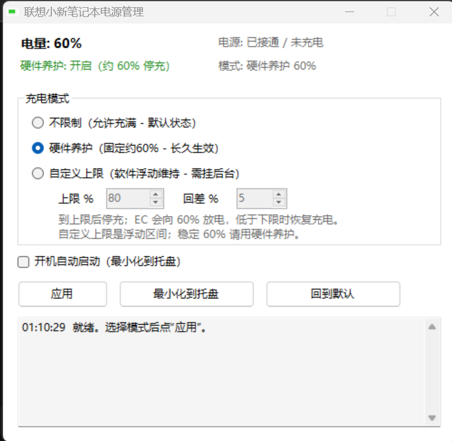

# 联想笔记本电池充电上限工具 · Lenovo Battery Ceiling

常年插电的笔记本，电池会一直顶在 100%。长期满电 + 高温，是电池鼓包、容量掉得最快的原因。

这个小工具把充电上限压下来：**插着电也只充到 60%（硬件养护）**，或者自己定个上限（比如 80%）。一个 20 KB 的 exe，双击就能用，不用安装、不用管理员权限。

> 它只调用联想固件自带的「电池养护」开关——和 Lenovo Vantage / 联想电脑管家里那个按钮是同一个接口。不刷固件、不改驱动。



## 适合谁

- 联想 IdeaPad / 小新 / Air 系列笔记本（系统里有 `Lenovo ACPI-Compliant Virtual Power Controller`，服务名 `ACPIVPC`）
- 长期插电当台式机用、想让电池少受点罪的人
- 本机实测：**小新 Air 14 2020（81YN）**，三种模式均验证通过
- 其他联想机型理论同源，程序会自己检测；不支持时界面会显示「硬件养护: 不可用」

不支持的：非联想机型，以及没装联想电源驱动的机器。

## 三步上手

1. 下载 [`BatteryCeiling.exe`](dist/BatteryCeiling.exe)（打开后点右上角 Download；也可以在 Releases 页下载）
2. 双击运行（不用装、不用管理员权限）
3. 选 **硬件养护（固定约60% - 长久生效）**，点 **应用**，再点右上角 ✕（窗口缩到托盘，限制在后台继续生效）

就这样。以后插着电，电量到 60% 左右就停充。

> 想开机就自动生效：先勾上「开机自动启动（最小化到托盘）」，再点应用。

## 三种模式，怎么选

| 模式 | 会发生什么 | 适合谁 |
|---|---|---|
| **不限制**（默认） | 关掉养护，正常充到 100% | 偶尔插电，或者要出远门满电带走 |
| **硬件养护**（推荐） | 打开固件养护，充到约 60% 停充，稳定保持 | 长期插电办公、挂机，最省心 |
| **自定义上限** | 到上限停充，掉到「上限 − 回差」再恢复充电，在区间里小幅充放 | 就想要 80% 附近、能接受充放波动的人 |

自定义上限需要后台维持：关窗口缩到托盘就行，别在托盘右键「退出」。

第一次开硬件养护时，如果电量已经高于 60%，会看到电量慢慢往下掉到 60% 附近——这是固件在放电，正常现象。

> 为什么不给一个「稳定停在 80%」？因为这台机器的固件只有三态（正常充 / 养护约60% / 快充），没有任意百分比接口。网上流传的注册表 `ChargeStopPercentage` 方案在这类 IdeaPad 上连对应的 WMI 类都不存在。完整逆向记录见 [docs/技术原理.md](docs/技术原理.md)。

## 常见问题

**1. Windows 提示「已保护你的电脑」，或杀毒软件报毒？**
exe 是自编译的、没有数字签名，SmartScreen 和部分杀软会拦。点「更多信息 → 仍要运行」即可。不放心就自己编译（见下），源码全在 `src/`。

**2. 界面显示「硬件养护: 不可用」？**
说明这台机器上没有 `\\.\EnergyDrv` 设备——没装联想电源驱动，或者机型本来就不支持。装/更新 Lenovo Vantage、联想电脑管家或芯片组驱动后再试。

**3. 关掉窗口，限制还在吗？**
在。关窗口只是缩到托盘。要彻底停止，托盘图标右键 →「退出」。

**4. 退出程序会不会把电脑卡在 60%？**
- 硬件养护模式：不会。退出后保留养护状态（和 Vantage 行为一致），想恢复就再打开选「不限制」。
- 自定义上限模式：会自动恢复普通充电，不留限制。

**5. 自定义上限为什么会在 75%–80% 之间来回充放？**
打开养护后，EC（嵌入式控制器）会把「养护」理解为「把电池放到 60%」，不是停在当前值。所以软件只能在「到上限就停、到下限就开」之间来回切换。回差调大 → 切换次数少，但下限也更低。

**6. 会不会伤电池、影响保修？**
它调的是联想官方电源管理里的同一个开关，不刷固件、不改 EC 表。任何第三方电源工具都有风险，介意就别用。

**7. 我装了 Lenovo Vantage / 电脑管家，会打架吗？**
会互相覆盖，谁最后写入谁生效。用本工具时，别同时开它们的养护开关。

**8. 怎么卸载？**
托盘右键「退出」→ 删掉 exe → 需要的话再清掉注册表配置：

```powershell
Remove-Item -LiteralPath 'HKCU:\Software\BatteryCeiling' -Recurse -Force -ErrorAction SilentlyContinue
Remove-ItemProperty -LiteralPath 'HKCU:\Software\Microsoft\Windows\CurrentVersion\Run' -Name 'BatteryCeiling' -ErrorAction SilentlyContinue
```

## 命令行（可选）

```cmd
BatteryCeiling.exe --diag       :: 把当前电量/充电状态写到 %LOCALAPPDATA%\BatteryCeiling\diag.txt
BatteryCeiling.exe --set-on     :: 直接开硬件养护（约 60%）
BatteryCeiling.exe --set-off    :: 直接关硬件养护（允许充满）
BatteryCeiling.exe --minimized  :: 启动后直接缩到托盘（开机自启用的就是它）
```

## 自己编译

不需要 Visual Studio，系统自带的 .NET Framework 4.x 就够：

```cmd
build.cmd
```

或者手动一行：

```cmd
%WINDIR%\Microsoft.NET\Framework64\v4.0.30319\csc.exe /target:winexe /optimize+ /out:dist\BatteryCeiling.exe src\BatteryCeiling.cs
```

产物是单个 `dist\BatteryCeiling.exe`，拷到哪都能跑，无外部依赖。

## 原理一句话

`\\.\EnergyDrv` → IOCTL `0x831020F8` → 固件方法 `GBMD`（读）/ `SBMC`（写）→ EC 字段 `BTSM`；`SBMC 3` 开养护、`SBMC 5` 关。和 Linux 内核 `ideapad-laptop.c` 用的是同一套接口。

完整调用链、DSDT 拆解、实测数据和参考链接：[docs/技术原理.md](docs/技术原理.md)

## 兼容性

- ✅ 小新 Air 14 2020（81YN，Win11 家庭版）：实测通过
- ⚠️ 其他 IdeaPad / 小新机型：同源接口，程序会自检；欢迎提交 issue 反馈机型
- ❌ 非联想机型：不支持

## 免责声明

本工具按「现状」提供，作者不对电池损坏、数据丢失或保修问题负责，使用风险自负。

## License

MIT © 2026 zhaclew

---

**English (short)**: A 20 KB Windows utility for Lenovo IdeaPad / XiaoXin laptops that caps charging at ~60% by toggling the firmware's battery conservation mode via the Lenovo ACPI virtual power controller (`\\.\EnergyDrv`, IOCTL `0x831020F8`, `SBMC 3/5`). No install, no admin rights, no firmware modification. Windows 10/11 + .NET Framework 4.x. Build with `build.cmd`.
